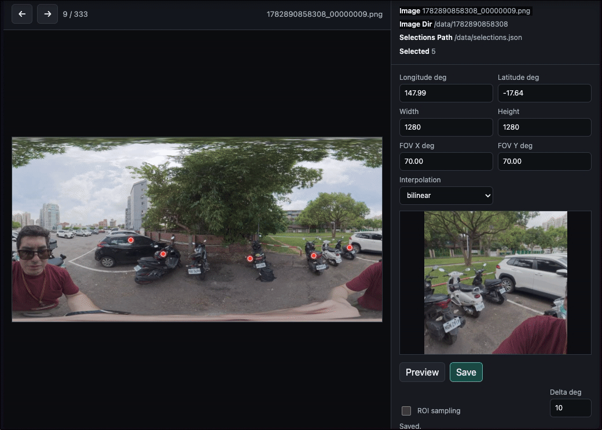
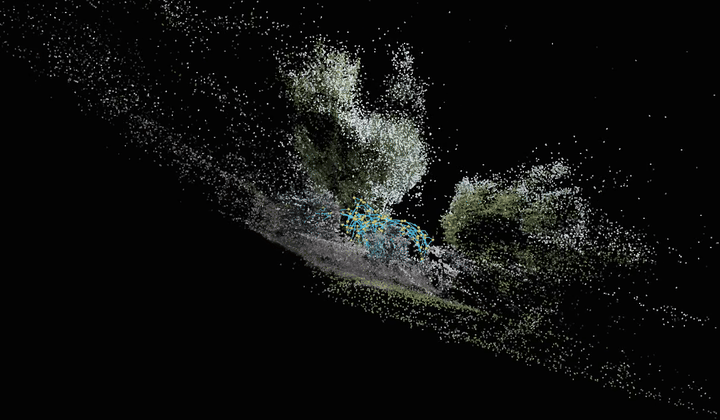

# colmap-360-reconstruction

Run a raw COLMAP sparse reconstruction from equirectangular panoramas by
using COLMAP's native `EQUIRECTANGULAR` camera model directly.

The primary 360-image workflow is:

1. Hard-link or symlink source panoramas into the COLMAP workspace.
2. Extract SIFT features with one shared native equirectangular camera.
3. Match panorama images with sequential, exhaustive, or vocabulary-tree matching.
4. Reconstruct, summarize, or visualize the raw sparse model.

The COLMAP output is monocular and unscaled. Do not treat it as metric geometry
until it has been aligned with an external scale source.

## Use it now

This is the shortest Docker-first path. It covers the two primary workflows:
native reconstruction directly from panoramas, and manual selection of pinhole
views.

### 1. Build and start the container

```bash
bash docker/docker_build.sh
bash docker/docker_run.sh
export COLMAP_REC=scene-reconstruction-colmap
```

`docker/docker_run.sh` sources `env`. Its user-configured `DATA` host path
(by default `~/data/360-data`) is mounted at `/data` in the container. Replace
the example scene directory below with a directory beneath your own `DATA`
path; `/data/1782890858308` is only an example.

### 2. Reconstruct panoramas, or start the pinhole workflow

Run a native panorama reconstruction when the source directory contains the
equirectangular panoramas you want to reconstruct:

```bash
docker exec -it "$COLMAP_REC" colmap-panorama-reconstruct \
  --input-image-path /data/1782890858308 \
  --workspace /data/colmap-equirectangular \
  --matcher sequential \
  --overlap 15 \
  --overwrite
```

Launch the selector when you first want to choose directions and render pinhole
views from panoramas:

```bash
docker exec -it "$COLMAP_REC" manual-pinhole-select \
  --image-dir /data/1782890858308 \
  --host 127.0.0.1 \
  --port 8765
```



Open the printed `http://127.0.0.1:8765` URL in a browser. By default, the
selector writes `selections.json` to the parent of the image directory; with
the example above, that is `/data/selections.json`. Pass `--output-dir` to use
a different location.
Use the selector in the browser:

- Click to preview a direction without saving it.
- Hold `Cmd` (macOS) or `Ctrl` (Linux/Windows) while clicking to save that
  direction and render its preview.
- Move the pointer near a saved point to highlight it; press `d` to delete the
  highlighted point.
- Press the left and right arrow keys to move to the previous or next
  panorama.

### 3. Render the saved pinhole views

Render one pinhole image per saved selection:

```bash
docker exec -it "$COLMAP_REC" manual-pinhole-render-selected \
  -s /data/selections.json \
  --image-dir /data/1782890858308 \
  -o /data/renders \
  -w 1280 \
  -h 1280 \
  --fov-x-deg 70 \
  --fov-y-deg 70
```

`--image-dir` is optional when `selections.json` contains `source.image_dir`.
If `-o/--output-dir` is not passed, the renderer writes to `renders/` beside
the selections file. The command above uses explicit paths so its inputs and
outputs are easy to locate.

The render stage writes:

```text
/data/renders/
/data/renders/render_report.json
```

Use `--workers N` to render panorama groups with multiple worker threads. The
default is `--workers 1`, which is slower but has predictable memory use.
Existing expected output images are reused by default, so rerunning the command
only renders missing selections. Pass `--overwrite` to regenerate existing
outputs. When a previous `render_report.json` exists, images listed in that old
report are deleted if their render identity is no longer present in the current
selections; pass `--keep-stale` to keep them. Render identity includes the
source panorama name, longitude, latitude, output size, FOV, interpolation, and
output extension, so matching output filenames alone are not reused when the
underlying view changed.

### 4. Attach COLMAP poses (optional)

After a native equirectangular COLMAP reconstruction exists, attach panorama
poses to the rendered pinhole views:

```bash
docker exec -it "$COLMAP_REC" manual-pinhole-attach-poses \
  -s /data/selections.json \
  --render-report /data/renders/render_report.json \
  --sparse-best /data/colmap-equirectangular/sparse_best \
  -o /data/pose-renders
```

If `-o/--output-dir` is not passed, the command writes to `posed-renders/`
beside the render report. The command fails when a selected panorama is missing
from the registered COLMAP model unless `--allow-missing-poses` is passed.

The pose attachment stage writes:

```text
/data/pose-renders/pose_report.json
/data/pose-renders/sparse/0/cameras.txt
/data/pose-renders/sparse/0/images.txt
/data/pose-renders/sparse/0/points3D.txt
```

This COLMAP text model can be used by downstream tools that expect pinhole
camera images and COLMAP-style camera poses.

### 5. Visualize or summarize COLMAP output

Summary mode works without Open3D:



```bash
docker exec -it "$COLMAP_REC" colmap-visualize \
  --model /data/colmap-equirectangular/sparse_best \
  --summary-only
```

Interactive visualization requires Open3D and GUI/OpenGL support:

```bash
docker exec -it "$COLMAP_REC" colmap-visualize \
  --model /data/colmap-equirectangular/sparse_best
```

For equirectangular workspaces, the visualizer automatically draws each
panorama as a small surface sphere with a local RGB arrow coordinate frame
instead of drawing a pinhole camera frustum. The sphere radius is one
quarter of the local frame size. The local frame is centered at the panorama
view center: +x points right, +y points down, and +z points through the
panorama center direction. You can override this if needed:

```bash
docker exec -it "$COLMAP_REC" colmap-visualize \
  --model /data/colmap-equirectangular/sparse_best \
  --camera-style sphere
```

For pose-attached pinhole render exports, draw pinhole camera frustums and the
exported point cloud:

```bash
docker exec -it "$COLMAP_REC" colmap-visualize \
  --model /data/pose-renders/sparse/0 \
  --camera-style pinhole
```

When the visualizer detects a nearby `pose_report.json` from
`manual-pinhole-attach-poses`, it shows untracked/synthetic `points3D` by
default because the derived pinhole export intentionally omits COLMAP feature
tracks. Use `--min-track-length N` to override that filtering behavior.

To save a preview image:

```bash
docker exec -it "$COLMAP_REC" colmap-visualize \
  --model /data/colmap-equirectangular/sparse_best \
  --save-image /data/colmap-equirectangular/map-preview.png \
  --summary-only
```

In headless containers this may fail if Open3D cannot create a rendering
window. Summary mode remains usable in that environment.

### 6. Know where outputs and assets live

Generated workspaces and scene data belong below `/data`. The repository is
mounted separately at `/workspace`; its verified local FAISS vocabulary-tree
asset is
`/workspace/data/colmap-vocab-tree-faiss/itri_vocab_tree_words8K.faiss.bin`,
not a file below `/data`.

## Details and extras

### Local installation and development

From the repository root:

```bash
python -m pip install -e .
```

For development tests:

```bash
python -m pip install -e '.[test]'
pytest -q
```

For COLMAP reconstruction support:

```bash
python -m pip install -e '.[colmap]'
python -c "import pycolmap; print(pycolmap.has_cuda)"
```

The final command must print `True`. Installing the CUDA wheel alongside the
ordinary `pycolmap` wheel is not sufficient because both packages provide the
same Python module.

For Open3D visualization support:

```bash
python -m pip install -e '.[visualize]'
```

You can combine extras:

```bash
python -m pip install -e '.[test,colmap,visualize]'
```

<!-- Task: TASK-0001 -->

### Renderer defaults

The standalone renderer helper constants are:

```text
width: 1280
height: 960
fov_x: 1.221730476 radians  # 70.0 degrees
fov_y: 0.967145867 radians  # 55.4 degrees
```

For these defaults, COLMAP uses:

```text
camera model: PINHOLE
fx: 914.0147247
fy: 914.006024013
cx: 640.0
cy: 480.0
```

These values assume all generated pinhole images share the same resolution and
field of view.

### Python API

```python
from render_pinhole import EquirectangularToPinhole

renderer = EquirectangularToPinhole.from_file("pano.png")
image = renderer.render(
    height=960,
    width=1280,
    longitude=0.0,
    latitude=0.0,
    fov_x=1.221730476,
    fov_y=0.967145867,
)
```

`image` is a NumPy array.

### Native panorama reconstruction reference

Use the maintained native equirectangular pipeline for 360 images:

```bash
colmap-panorama-reconstruct \
  --input-image-path /data/panoramas \
  --workspace /data/colmap-equirectangular \
  --matcher sequential \
  --overlap 15 \
  --overwrite
```

The command imports each source panorama into the COLMAP workspace with a hard
link when possible and a symbolic link fallback across filesystems. It then
uses COLMAP's native `EQUIRECTANGULAR` camera model with one shared camera,
`CameraMode.SINGLE`, and fixed equirectangular camera parameters derived from
the panorama resolution. No virtual pinhole views, masks, rig configuration,
or render-encoding arguments are used.

COLMAP feature extraction, matching, and bundle adjustment use CUDA
automatically when the installed pycolmap build supports it:

```bash
--device auto \
--gpu-index -1
```

To require CUDA and fail instead of falling back to CPU:

```bash
--device cuda \
--gpu-index 0
```

Multiple GPU indices distribute feature extraction and matching across GPUs.
Bundle adjustment requests the first selected GPU:

```bash
--device cuda \
--gpu-index 0,1,2,3
```

Disable GPU bundle adjustment while retaining GPU SIFT with
`--no-gpu-bundle-adjustment`. Some CUDA pycolmap wheels are built with a
CPU-only Ceres solver. In that case, COLMAP logs a warning and automatically
falls back to CPU bundle adjustment.

Start with a small smoke reconstruction before a full run:

```bash
colmap-panorama-reconstruct \
  --input-image-path /data/panoramas \
  --workspace /data/colmap-equirectangular-smoke \
  --image-limit 12 \
  --no-loop-detection \
  --overwrite
```

Loop detection may download COLMAP's default vocabulary tree. To avoid that
download and make runs reproducible, pass a local tree with
`--vocab-tree-path /path/to/vocab_tree.bin`. The command automatically points
COLMAP/libcurl at `/etc/ssl/certs/ca-certificates.crt` when available; override
it with `--ssl-cert-file` when needed.

For larger ordered panorama captures, keyframe matching can reduce the pair
list before COLMAP matching. The sequential-vocabtree selector clusters images
in capture order using vocabulary-tree candidate pairs, selects a keyframe per
cluster, and writes an imported pair list:

```bash
colmap-panorama-reconstruct \
  --input-image-path /path/to/panoramas \
  --workspace /workspace/data/colmap-equirectangular-keyframes \
  --matcher keyframes \
  --keyframe-selection sequential-vocabtree \
  --vocab-tree-path /path/to/vocab_tree.bin \
  --keyframe-backbone-policy gaps \
  --keyframe-backbone-overlap 1 \
  --overwrite
```

For deterministic testing without a vocabulary tree, use interval keyframes:

```bash
--matcher keyframes \
--keyframe-selection interval
```

To run only the keyframe clustering/pair-planning stage after image import and
feature extraction, use the standalone cluster command:

```bash
tools-download-colmap-vocab-tree \
  --format faiss \
  --variant 256k \
  --destination-dir /workspace/data/colmap-vocab-tree

colmap-panorama-clusters \
  --workspace /workspace/data/colmap-equirectangular-keyframes \
  --vocab-tree-path /workspace/data/colmap-vocab-tree/vocab_tree_faiss_flickr100K_words256K.bin \
  --keyframe-selection sequential-vocabtree
```

This writes `match_pairs.txt` for COLMAP matching and
`panorama_keyframe_cluster_report.json` with the selected keyframes, clusters,
and pair counts.

The workspace includes `panorama_equirectangular_config.json` and
`panorama_equirectangular_report.json`. The metadata marks `camera_setup` as
`native_equirectangular`, and the report records feature health, matching
settings, registered panorama images, and sparse model statistics.

To measure the gain from vocabulary-tree matching or vocabtree-backed keyframes,
run the same input twice into separate workspaces and compare the reports:

```bash
colmap-panorama-reconstruct \
  --input-image-path /path/to/panoramas \
  --workspace /workspace/data/colmap-equirectangular-sequential \
  --matcher sequential \
  --overwrite

colmap-panorama-reconstruct \
  --input-image-path /path/to/panoramas \
  --workspace /workspace/data/colmap-equirectangular-vocabtree \
  --matcher vocabtree \
  --vocab-tree-path /path/to/vocab_tree.bin \
  --overwrite

colmap-panorama-compare \
  --baseline /workspace/data/colmap-equirectangular-sequential/panorama_equirectangular_report.json \
  --candidate /workspace/data/colmap-equirectangular-vocabtree/panorama_equirectangular_report.json
```

Use the same feature settings, image limit, device, thread count, and GPU index
for both runs. Treat lower matching/runtime numbers as a speed gain only if the
candidate preserves acceptable registered-image count, sparse point count, and
reprojection error.

### Pinhole workflow reference

The current pinhole workflow is split into three stages:

1. Select longitude/latitude directions from the panorama images.
2. Render pinhole images from those selected directions.
3. Attach poses from an existing native equirectangular COLMAP reconstruction
   when a pose-aware output is needed.

Selection and rendering are pure image operations. They do not require COLMAP,
`pycolmap`, `sparse_best`, optimized poses, or rig metadata. Pose attachment is
the only stage that reads the reconstructed COLMAP model.

#### Stage 1: Select directions

Launch the selector directly from a directory of equirectangular panorama
images:

```bash
manual-pinhole-select \
  --image-dir /data/images \
  --host 127.0.0.1 \
  --port 8765
```

Open the printed URL, for example `http://127.0.0.1:8765`. If `--output-dir`
is not passed, the selector writes beside the image directory:

```text
/data/selections.json
```

The panorama image is an equirectangular view:

- Horizontal position maps to longitude.
- The left edge is `-180` degrees, the center is `0` degrees, and the right
  edge is `+180` degrees.
- Vertical position maps to latitude.
- The top edge is `+90` degrees, the center is `0` degrees, and the bottom edge
  is `-90` degrees.

Basic selection behavior:

- Click once to render only a preview of that longitude/latitude direction.
- Press `Cmd` or `Ctrl` while clicking to save the direction and render its
  preview.
- Press the left and right arrow keys to move to the previous or next panorama.
- Move near an existing saved point to highlight it. Press `d` while a point is
  highlighted to delete it.
- Use `Preview`, `Save`, `Check`, `Delete`, `Undo`, `Reset Pano`, and
  `Reset Collection` to manage saved selections.

For faster batch selection, enable `ROI sampling`, draw a box from the upper
left to the lower right of the region you want, and set `Delta deg`. The tool
samples a spherical grid inside that box using the chosen angular spacing.
Rows near the panorama poles contain fewer longitude samples because the
corresponding latitude rings are smaller on the sphere. Smaller deltas create
more views; larger deltas create fewer views.

Good manual selections usually follow these rules:

- Prefer textured, well-lit, non-blurry areas with useful geometry.
- Avoid crops dominated by blank walls, floor, ceiling, reflective surfaces, or
  heavy motion blur.
- Avoid latitudes very close to `+90` or `-90` degrees unless you explicitly
  need pole-facing views.
- Keep the FOV and resolution consistent for a downstream training set unless
  you have a specific reason to vary intrinsics.

#### Reconstruct with higher-resolution pinhole images

`colmap-pinhole-reconstruct` can use one render report as the metadata/FOV
manifest while reading the actual images from a different directory. This is
useful when you render the same selected views again at a higher resolution.

Use the original `render_report.json` for:

- selected view identity;
- output image names;
- FOV;
- provenance for pose-report matching.

Use `--image-dir` for the actual image files that should be imported into the
COLMAP workspace. Files are matched by `renders[].output_name`, and the pipeline
reads the actual image resolution from those files before deriving the shared
`PINHOLE` intrinsics. This means an x2 image directory with the same FOV but
twice the width/height gets x2-resolution intrinsics automatically.

Example using x1 metadata and x2 rendered images:

```bash
colmap-pinhole-reconstruct \
  --render-report /data/render_report.json \
  --image-dir /data/images \
  --pose-report /data/pose_report.json \
  --initial-poses-from-pose-report \
  -w /data/pose-priors \
  --num-threads 4 \
  --import-workers 100 \
  --max-num-features 16384 \
  --overwrite
```

Before running, make sure every `output_name` listed in the x1
`render_report.json` exists in the x2 image directory. If any x2 image is still
rendering or missing, import fails fast with the missing filename.

When `--pose-report` is passed, camera-center position priors are enabled by
default. Pass `--no-use-position-priors` to keep the pose report as coverage
metadata only while running an unconstrained comparison.

For higher-resolution images, consider increasing `--max-num-features` from the
default `8192`; `16384` is a practical first x2 setting. The default
`--max-image-size -1` keeps COLMAP feature extraction at the full imported image
resolution.

#### Example workspace

For the tested workspace:

```bash
manual-pinhole-select \
  --image-dir /data/itri-3d-reconstruction/scene-reconstruction/2026-07-02-001/images
```

```bash
manual-pinhole-render-selected \
  -s /data/itri-3d-reconstruction/scene-reconstruction/2026-07-02-001/selections.json \
  --image-dir /data/itri-3d-reconstruction/scene-reconstruction/2026-07-02-001/images \
  -o /data/itri-3d-reconstruction/scene-reconstruction/2026-07-02-001/renders \
  -w 1280 \
  -h 1280 \
  --fov-x-deg 70 \
  --fov-y-deg 70
```

```bash
manual-pinhole-attach-poses \
  -s /data/itri-3d-reconstruction/scene-reconstruction/2026-07-02-001/selections.json \
  --render-report /data/itri-3d-reconstruction/scene-reconstruction/2026-07-02-001/renders/render_report.json \
  --sparse-best /data/itri-3d-reconstruction/scene-reconstruction/2026-07-02-001/sparse_best \
  -o /data/itri-3d-reconstruction/scene-reconstruction/2026-07-02-001/pose-renders
```


### Utility scripts

Create a sampled directory of image symlinks:

```bash
tools-sampling \
  --source /path/to/images \
  --destination /path/to/sampled-images \
  --skip 4 \
  --idx 0
```

Extract video frames through the bundled shell wrapper:

```bash
tools-proc-video /path/to/video.mp4 5
```

Shift extracted equirectangular panoramas horizontally:

```bash
tools-shift-panorama \
  --input /path/to/video-frame-directory \
  --output /path/to/shifted-video-frame-directory \
  --theta 180 \
  --workers 8
```

### Important limits

- COLMAP output is raw monocular geometry in arbitrary scale and frame.
- Metric scale recovery is not implemented for the current dataset.
- `data/` is ignored by git because COLMAP workspaces are generated artifacts.

### Run tests

```bash
pytest -q
```
